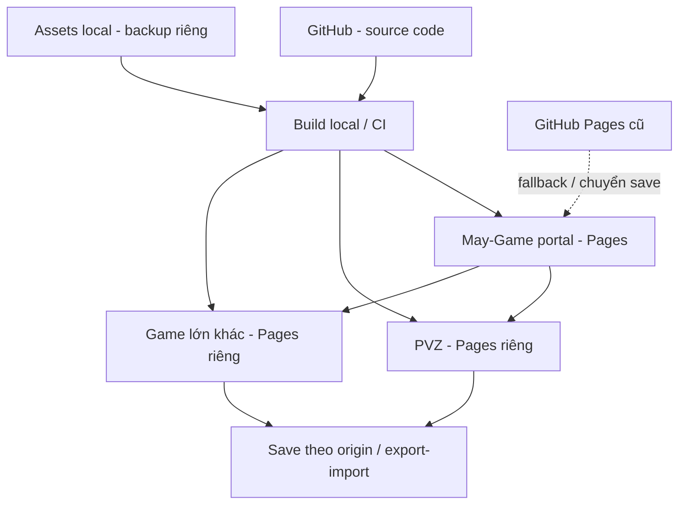

# May-Game — Kế hoạch migration từ GitHub Pages sang Cloudflare

> Ngày lập: 27/11/2026 · Trạng thái: đã triển khai một phần  
> Repository: https://github.com/NCQH/May-Game  
> Website: https://may-game.pages.dev/ · GitHub Pages: đã bỏ  
>
> **Cập nhật 27/11/2026:** đã chốt bỏ GitHub Pages, không banner và không thông báo migrate. Kế hoạch thực thi hiện tại: [docs/CLOUDFLARE-MIGRATION.md](./docs/CLOUDFLARE-MIGRATION.md).

## 1. Mục tiêu và phạm vi

- [ ] Giải quyết giới hạn dung lượng hosting hiện tại, đặc biệt với Plants vs. Zombies (PVZ).
- [ ] Duy trì kiến trúc web tĩnh; không thuê VPS, không yêu cầu backend để chơi offline/single-player.
- [ ] Ưu tiên chi phí 0 đồng, không kích hoạt dịch vụ tính phí nếu chưa được duyệt.
- [ ] Giữ GitHub để quản lý mã nguồn; deploy trực tiếp bản build từ máy local khi cần.
- [ ] Hỗ trợ mở rộng thêm Gunny, Bang Bang, Boom Online và các game khác nếu có phiên bản web phù hợp.
- [ ] Không làm mất save game, không phá vỡ đường dẫn cũ và có phương án rollback.

**Giả định:** May-Game hiện được phục vụ dưới `/May-Game/` trên GitHub Pages. Chưa kiểm tra cây thư mục, workflow build, số file, dung lượng thực tế hoặc định dạng save của phiên bản hiện tại. Các tên project và thư mục dưới đây là đề xuất, cần điều chỉnh sau khi audit repo. Migration hosting không tự biến game yêu cầu server thành game offline.

## 2. Quyết định kiến trúc

### 2.1. Phương án chính: Cloudflare Pages Free + Direct Upload

Thực hiện theo hai bước, không chuyển toàn bộ hệ thống cùng lúc:

1. Deploy bản May-Game hiện tại lên một project Cloudflare Pages thử nghiệm, giữ nguyên GitHub Pages.
2. Tách các game lớn thành project độc lập khi cần. Các game nhỏ có thể tiếp tục nằm cùng portal nếu đáp ứng quota.



| Thành phần | URL minh họa | Vai trò |
|---|---|---|
| Portal | `may-game.pages.dev` | Home, danh mục, metadata, UI chung, game nhỏ |
| PVZ | `may-pvz.pages.dev` | Engine, audio, sprite, dữ liệu PVZ |
| Gunny | `may-gunny.pages.dev` | Bản offline khi sẵn sàng |
| Bang Bang | `may-bangbang.pages.dev` | Bản offline khi sẵn sàng |
| Boom | `may-boom.pages.dev` | Game độc lập |
| GitHub Pages cũ | `ncqh.github.io/May-Game/` | Fallback và trang hướng dẫn chuyển save |

Tên miền trên chỉ minh họa; Cloudflare sẽ cấp hostname thực tế tùy tên còn trống. Chỉ tạo project cho game đã sẵn sàng triển khai, không tạo hàng loạt project rỗng để tận dụng quota.

### 2.2. Hạn mức và lựa chọn dịch vụ

Đối chiếu tài liệu Cloudflare ngày 27/11/2026.

| Hạn mức | Pages Free | Workers Static Assets Free |
|---|---|---|
| Project/tài khoản | 100 | 100, tách riêng với Pages |
| File tĩnh/project hoặc Worker version | 20.000 | 20.000 |
| File đơn lẻ | 25 MiB | 25 MiB |
| Request tới static assets | Miễn phí, không giới hạn theo tài liệu | Miễn phí, không giới hạn theo tài liệu |
| Tổng dung lượng | Không nêu trần GB cố định trong trang limits | Không tính thêm phí lưu static assets; vẫn có giới hạn file |
| Upload local | Wrangler | Wrangler |

Pages có hạn mức 500 builds/tháng trên Free; theo dõi thêm deployment limit và chính sách sử dụng. Không hiểu quota project là cam kết lưu trữ vô hạn. Không chia nhỏ một dịch vụ giả tạo để né chính sách.

**Workers Static Assets:** lựa chọn thay thế cho project mới; không cần Worker script nếu chỉ phục vụ file tĩnh. Cloudflare có hướng dẫn migration Pages → Workers. Tuy nhiên, tài liệu Workers hiện nêu hạn chế về HTTP Range: có thể trả toàn bộ file thay vì `206 Partial Content`. Cần test audio/video của game trước khi chọn Workers.

**R2:** chưa sử dụng ở phase đầu. Chỉ xem xét nếu có asset không thể giảm xuống dưới 25 MiB, hoặc cần kho asset dùng chung. R2 Standard có free tier 10 GB-month, 1 triệu Class A và 10 triệu Class B operations/tháng; egress miễn phí. Vượt quota vẫn phát sinh phí. Public URL `r2.dev` chỉ dành cho phát triển, không dùng làm CDN production. Nếu cần R2 production, phải đánh giá custom domain/Worker gateway, caching, request quota và chi phí trước khi bật.

## 3. Phase 0 — Audit và backup

### 3.1. Kiểm tra môi trường

```bash
git status --short
git rev-parse HEAD
git remote -v
node --version
npm --version
```

Dùng Node.js LTS còn được hỗ trợ bởi Wrangler hiện tại (ví dụ Node 24 nếu phù hợp); không mặc định Node 18 cũ còn tương thích. Pin phiên bản Wrangler đã test trong tooling/lockfile thay vì dùng bản mới nhất tùy mỗi lần CI chạy.

Xác định thư mục publish thật sự từ GitHub Pages settings và workflow `.github/workflows/`. Không mặc định `dist/` nếu dự án publish thư mục khác hoặc HTML nằm ở root.

### 3.2. Đo kích thước bản publish

Thay `./dist` bằng đúng thư mục output. Chỉ audit bản publish đã chuẩn bị, không đưa `.git`, dependencies, Python env hay mã nguồn riêng tư lên CDN.

```bash
OUT=./dist
test -f "$OUT/index.html" || { echo 'Sai output directory'; exit 1; }
du -sh "$OUT"
du -h --max-depth=2 "$OUT" | sort -hr | head -30
find "$OUT" -type f | wc -l
find "$OUT" -type f -size +26214400c -print
find "$OUT" -type f -printf '%s\t%p\n' | sort -nr | head -30 | numfmt --field=1 --to=iec
find "$OUT" -type l -print
```

| Metric | Trước migration | Mục tiêu |
|---|---|---|
| Tổng dung lượng publish | TODO | Ghi nhận theo từng game |
| Số file portal | TODO | ≤ 16.000 (buffer nội bộ 20%) |
| Số file PVZ | TODO | ≤ 16.000 (buffer nội bộ 20%) |
| File lớn nhất | TODO | ≤ 25 MiB, ưu tiên ≤ 20 MiB |
| Cold load PVZ / warm load | TODO | Không kém baseline đáng kể |
| Save schema và storage keys | TODO | Export/import kiểm thử thành công |

### 3.3. Backup

- [ ] Ghi lại commit SHA và giữ một bản release build đầy đủ đang chạy tốt.
- [ ] Backup asset gốc có giấy phép sử dụng, metadata, manifest và hash SHA-256 ở máy local/ổ lưu trữ riêng.
- [ ] Kiểm tra tài nguyên nào cần bảo tồn bên ngoài GitHub để build có thể tái lập.
- [ ] Ghi nhận route, service worker scope, cache version và cấu trúc save hiện tại.
- [ ] Không xóa asset khỏi Git history trong giai đoạn này. Rewrite history là công việc riêng, cần backup và đánh giá ảnh hưởng clone/fork/CI.

## 4. Phase 1 — Deploy nguyên trạng lên Pages

### 4.1. Chuẩn bị bản publish sạch

Tạo output riêng, chỉ chứa các file cần phục vụ trên web. Không upload cả repo nếu có `.git`, `.env`, token, file backup, source server, database dump, node_modules hay file dev không cần thiết. Kiểm tra license của code, audio, sprite và tài nguyên game trước khi public.

### 4.2. Sửa đường dẫn trước khi deploy

GitHub Pages project thường dùng `/May-Game/`, còn Cloudflare Pages dùng root `/`. Tìm các hardcode sau trong source:

```bash
rg -n 'ncqh\.github\.io|/May-Game/|localhost|127\.0\.0\.1' \
  --glob '!node_modules/**' --glob '!dist/**' .
```

- Ưu tiên đường dẫn tương đối hoặc cấu hình base URL theo môi trường; tránh replace hàng loạt khi chưa hiểu ngữ cảnh.
- Kiểm tra `fetch()`, import động, asset manifest, CSS `url()`, audio, WASM locateFile, worker scripts, favicon và đường dẫn các màn hình game.
- Nếu dùng Vite, cấu hình `base` phù hợp với từng target. Nếu dùng HTML/JS thuần, ưu tiên relative path; không bắt buộc chuyển framework.
- Kiểm tra service worker `scope`, `start_url` và manifest PWA.
- Thêm trang `404.html` nếu phù hợp để tránh trả HTML fallback cho asset thiếu; nếu portal là SPA thì cấu hình routing phù hợp và kiểm tra response thật của JS/WASM.

### 4.3. Tạo project và upload bằng Wrangler

Tạo tài khoản Cloudflare Free, vào Workers & Pages. Chọn Direct Upload cho phép deploy từ máy local mà không cần tất cả assets nằm trên GitHub. Project Direct Upload không chuyển trực tiếp sang Git integration; vẫn có thể dùng CI gọi Wrangler sau này.

```bash
# Chạy trong thư mục tooling/project với Node LTS phù hợp
npm install --save-dev --save-exact wrangler
npx wrangler --version
npx wrangler login
npx wrangler whoami

# Tạo một lần; chọn tên còn trống và production branch main
npx wrangler pages project create may-game --production-branch main

# Preview trước, không thay production
npx wrangler pages deploy ./dist --project-name may-game --branch migration-test
```

Dùng URL preview thực tế mà Wrangler trả về để test. Thay `./dist` bằng output thật. Sau khi đạt checklist nghiệm thu:

```bash
npx wrangler pages deploy ./dist --project-name may-game --branch main
npx wrangler pages deployment list --project-name may-game
```

Giữ nguyên GitHub Pages trong toàn bộ quá trình. Nếu bản publish không đạt giới hạn, không cố upload; chuyển sang Phase 2 và/hoặc Phase 3.

## 5. Phase 2 — Tách PVZ và các game lớn

### 5.1. Tách deployment, không bắt buộc tách repository

Có thể giữ monorepo May-Game và sinh nhiều output độc lập:

```text
May-Game/                         # bố cục đề xuất, không phải cây repo hiện tại
├── src/                         # portal và code chia sẻ
├── games/
│   ├── pvz/
│   ├── gunny/                   # khi có bản web hợp lệ
│   └── boom/
├── assets/                      # source assets đủ quyền sử dụng
├── scripts/
│   ├── check-static.py
│   └── build-portal / build-game
├── dist/                        # generated, không commit nếu không cần
│   ├── portal/
│   └── pvz/
└── .github/workflows/
```

Mỗi output phải chứa đầy đủ file cần thiết cho game tương ứng, không dựa vào đường dẫn local của monorepo. Portal không copy toàn bộ asset PVZ vào output của mình. Không load asset nặng ngay khi vào trang chủ.

```bash
npx wrangler pages project create may-pvz --production-branch main
npx wrangler pages deploy ./dist/pvz --project-name may-pvz --branch migration-test
# Sau khi test thành công:
npx wrangler pages deploy ./dist/pvz --project-name may-pvz --branch main
npx wrangler pages deploy ./dist/portal --project-name may-game --branch main
```

### 5.2. Game manifest tập trung

Portal dùng một manifest để điều hướng, không hardcode URL rải rác. Ví dụ (URL phải thay bằng URL triển khai thật):

```json
{
  "schemaVersion": 1,
  "games": [
    {
      "id": "pvz",
      "title": "Plants vs. Zombies",
      "status": "available",
      "entryUrl": "https://may-pvz.pages.dev/",
      "legacyUrl": "https://ncqh.github.io/May-Game/",
      "launchMode": "navigation",
      "saveSchemaVersion": 1
    }
  ]
}
```

`legacyUrl` cần trỏ đến đúng route PVZ cũ sau audit. Game chưa hoàn thiện để `status: planned` và không hiển thị link hỏng.

**Launch mode mặc định:** điều hướng trực tiếp đến game, kèm nút quay lại portal. Iframe chỉ dùng khi thực sự cần giữ UI chung; cross-origin iframe có thể bị hạn chế storage, fullscreen, audio autoplay và pointer lock. Nếu dùng `postMessage`, kiểm tra chính xác `event.origin`, `event.source`, schema và `targetOrigin`; không dùng `*` cho dữ liệu save.

### 5.3. Save game: tránh mất tiến trình

LocalStorage, IndexedDB, Cache API và service worker thuộc origin. Chuyển từ `ncqh.github.io` sang `pages.dev`, hoặc tách portal và PVZ sang hai hostname, sẽ không tự mang theo save.

- [ ] Xác định toàn bộ key LocalStorage, database/object store IndexedDB và dữ liệu filesystem ảo (nếu WASM dùng IDBFS).
- [ ] Bổ sung Export save (JSON hoặc định dạng backup phù hợp) ở origin cũ, ưu tiên dùng chính API lưu game hiện có.
- [ ] Bổ sung Import save tại origin mới; validate schema, giới hạn kích thước, kiểm tra version và backup save hiện tại trước khi ghi đè.
- [ ] Test export → import → reload → tiếp tục chơi → export lại.
- [ ] Giữ trang legacy có hướng dẫn chuyển save; không redirect cưỡng bức trước khi người chơi có cơ hội export.
- [ ] Không lưu token, credential hay dữ liệu nhạy cảm trong file save.

Không thể đồng bộ trực tiếp save giữa hai origin bằng cách đọc LocalStorage của nhau. Nếu muốn đồng bộ đa thiết bị trong tương lai, đó là tính năng riêng, có thể cần backend và đánh giá quyền riêng tư.

## 6. Phase 3 — Tối ưu assets và xử lý file lớn

Chỉ thực hiện sau khi có baseline và xác định bottleneck. Không nén lại toàn bộ asset chỉ để giảm dung lượng nếu làm sai màu, alpha, timing animation hoặc chất lượng âm thanh.

| Vấn đề | Hướng xử lý |
|---|---|
| Quá nhiều sprite nhỏ | Atlas/spritesheet theo nhóm, giữ metadata tọa độ, padding và alpha |
| PNG nặng | Thử WebP lossless; test engine, pixel fidelity và alpha |
| Audio nặng | OGG/Opus hoặc AAC tùy browser/runtime; giữ loop points và sample rate cần thiết |
| Asset trùng lặp | Deduplicate theo hash; không gộp tài nguyên khác license tùy tiện |
| Game tải quá nhiều ngay đầu | Lazy load theo màn/level, preload nhóm thiết yếu |
| File >25 MiB | Tối ưu hoặc chia chunk nếu loader hỗ trợ; nếu không, cân nhắc R2 sau khi duyệt |
| WASM lớn | Build release tối ưu, bỏ debug symbols nếu phù hợp; không cắt file WASM tùy ý |
| Quá 20.000 file | Tách ứng dụng thực sự độc lập hoặc pack assets theo format engine hỗ trợ |

Chunking chỉ có ý nghĩa nếu runtime biết tải và ghép đúng, hoặc có bộ loader hỗ trợ range/chunk. Không đổi extension hay chia ZIP rồi kỳ vọng browser tự chạy. Lưu ý chi phí CPU/RAM trên mobile khi giải nén asset.

### Cache và HTTP headers

Ví dụ `_headers` đặt trong output Pages (chỉ dùng immutable nếu tên file đã có content hash):

```text
/assets/hashed/*
  Cache-Control: public, max-age=31536000, immutable

/game-manifest.json
  Cache-Control: no-cache

/index.html
  Cache-Control: no-cache
```

Với WASM multithreading/SharedArrayBuffer, test nhu cầu cross-origin isolation trước khi bật COOP/COEP. Nếu cần, áp dụng trên document game phù hợp và kiểm tra tất cả subresources cross-origin. Không bật đại trà vì có thể phá iframe hoặc tích hợp khác.

Nếu portal chỉ điều hướng đến game, không cần mở CORS. Nếu thực sự fetch asset cross-origin, cấu hình CORS cho origin cụ thể, MIME đúng (đặc biệt `application/wasm`) và kiểm tra response bằng DevTools. Không cho phép mọi origin nếu không cần.

## 7. Phase 4 — Tự động hóa preflight và deployment

### 7.1. Script kiểm tra quota

Lưu ví dụ sau vào `scripts/check-static.py`. Script áp dụng cho output đã build, không dùng thay thế việc review nội dung public.

```python
from pathlib import Path
import sys

root = Path(sys.argv[1]).resolve()
if not root.is_dir() or not (root / 'index.html').is_file():
    raise SystemExit(f'Invalid static output: {root}')

MAX_FILES = 20_000
MAX_BYTES = 25 * 1024 * 1024
blocked = {'.git', 'node_modules', '.venv', '__pycache__'}
files, errors, total = [], [], 0

for p in root.rglob('*'):
    rel = p.relative_to(root)
    if p.is_symlink():
        errors.append(f'Symlink: {rel}')
        continue
    if any(part in blocked or part == '.env' or part.startswith('.env.')
           for part in rel.parts):
        errors.append(f'Unexpected private/dev path: {rel}')
        continue
    if p.is_file():
        size = p.stat().st_size
        files.append(p)
        total += size
        if size > MAX_BYTES:
            errors.append(f'Oversized: {rel} ({size / 2**20:.2f} MiB)')

if len(files) > MAX_FILES:
    errors.append(f'File count {len(files)} > {MAX_FILES}')
print(f'{len(files)} files | {total / 2**20:.2f} MiB')
if len(files) > 16_000:
    print('WARNING: less than 20% file-count headroom')
for e in errors:
    print('ERROR:', e)
sys.exit(1 if errors else 0)
```

```bash
python3 scripts/check-static.py ./dist/portal
python3 scripts/check-static.py ./dist/pvz
```

### 7.2. Deploy local trước, CI sau

Giai đoạn đầu dùng local deploy vì asset nặng có thể không còn nằm trên GitHub. Khi CI có thể build tái lập toàn bộ output từ nguồn hợp lệ, mới tự động hóa.

CI cần `CLOUDFLARE_API_TOKEN` có quyền Pages Edit phù hợp và `CLOUDFLARE_ACCOUNT_ID` lưu trong GitHub Actions secrets. Không hardcode token trong source hay client. Dùng job riêng cho game thay đổi; chạy build + preflight trước deploy. Dùng dependency lockfile, `npm ci` và giới hạn concurrency theo project. Không cho CI deploy production từ PR không tin cậy.

Lệnh CI cốt lõi sau khi build:

```bash
python3 scripts/check-static.py ./dist/portal
npx wrangler pages deploy ./dist/portal --project-name may-game --branch main
```

Không tạo workflow hoàn chỉnh dựa trên build command giả định: cần xác nhận pipeline repo thật trước. Nếu CI không có assets, tiếp tục Direct Upload từ máy local thay vì deploy bản thiếu file.

### 7.3. Quản lý repository và release

- Giữ source code, asset manifest, license, hash và scripts build trong Git.
- Chỉ bỏ generated output và asset lớn khỏi Git khi đã có bản backup và phương án build tái lập.
- Không coi Cloudflare deployment là backup duy nhất của tài nguyên gốc.
- Deploy game trước, cập nhật portal manifest sau khi game đã healthy.
- Giữ một số phiên bản asset hash tương thích nếu trang cũ còn mở; theo dõi cache/version skew.

## 8. Phương án thay thế — Workers Static Assets

Nếu quyết định dùng Workers cho game mới thay vì Pages, có thể bắt đầu với một cấu hình chỉ phục vụ assets, không có Worker script:

```jsonc
{
  "name": "may-pvz",
  "compatibility_date": "2026-11-27",
  "assets": {
    "directory": "./dist/pvz"
  }
}
```

Lưu dưới `wrangler.jsonc` trong workspace phù hợp, điều chỉnh path thực tế rồi chạy:

```bash
npx wrangler deploy --dry-run
npx wrangler deploy
```

URL `workers.dev` do tài khoản cấp. Không thêm `main`, `run_worker_first`, API hoặc SSR nếu chỉ cần static assets. Kiểm thử HTTP Range và MIME, cache, audio/video, WASM, routing. Nếu game cần Range thực sự mà Workers Static Assets không đáp ứng, giữ Pages hoặc đánh giá một giải pháp phù hợp hơn. Không tạo hai bản production song song nếu không có nhu cầu thực tế.

## 9. Phase 5 — QA và nghiệm thu

| Kiểm thử | Điều kiện đạt |
|---|---|
| Portal | Home, danh sách, tìm kiếm, game cards, điều hướng hoạt động |
| PVZ | Mở game, chọn mode/level, chơi, thắng/thua, pause/restart |
| Assets | Không 404, MIME sai, CORS lỗi hoặc HTML trả về thay JS/WASM |
| Audio | Nhạc, SFX, loop, volume, mute, pause/resume đúng |
| Save | Export/import giữa GitHub Pages và Cloudflare thành công |
| Cache | Reload, cập nhật version, mở tab cũ và tab mới không gây lỗi |
| WASM/worker | Init đúng, worker path đúng, isolation nếu cần |
| Thiết bị | Chrome/Edge/Firefox desktop; Android/iOS nếu game hỗ trợ |
| Performance | So sánh cold/warm load, request count, bytes, RAM, thời gian bắt đầu chơi |
| Free tier | Không có dịch vụ tính phí ngoài dự kiến, quota có buffer |
| Security | Không publish secret, file private, tài nguyên không được cấp phép |
| Rollback | Có thể phục hồi bản release trước và hướng dẫn quay lại URL cũ |

Ghi kết quả từng test kèm browser/version, URL, release SHA và lỗi tái hiện. Dùng DevTools Network (Disable cache cho cold test), Application/Storage và Console. Có thể thêm Playwright smoke test sau khi xác định selectors của repo thật. Không tuyên bố game chạy offline khi mất mạng hoàn toàn nếu chưa có PWA/service worker cache đầy đủ: web tĩnh không backend khác với khả năng chơi không có Internet ngay từ lần đầu.

## 10. Phase 6 — Cutover và rollback

### Cutover

1. Xác nhận mọi tiêu chí bắt buộc ở Phase 5.
2. Deploy PVZ production, kiểm tra URL trực tiếp.
3. Deploy portal với manifest trỏ đến PVZ production.
4. Thêm banner trên GitHub Pages cũ dẫn đến website mới và hướng dẫn export/import save. Ban đầu ưu tiên link/redirect tự nguyện.
5. Cập nhật README, link chia sẻ, canonical URL phù hợp và tài liệu deployment.
6. Giữ bản legacy trong giai đoạn chuyển tiếp (đề xuất ít nhất 2–4 tuần, điều chỉnh theo người dùng thực tế và quota).
7. Sau khi xác minh save và traffic, có thể chuyển GitHub Pages cũ thành landing page nhẹ; không xóa công cụ chuyển save quá sớm.

### Rollback

- Lỗi game mới: rollback riêng project game từ Cloudflare Dashboard → Deployments → bản production tốt trước đó; kiểm tra lại manifest portal.
- Lỗi portal: rollback riêng portal hoặc cập nhật manifest trỏ về URL game tốt.
- Lỗi nghiêm trọng: sử dụng GitHub Pages legacy và artifact release backup.
- Deployment cũ có thể hết thời hạn giữ theo chính sách Cloudflare; phải lưu artifact riêng có thể redeploy.
- Rollback code không tự rollback save người chơi; dùng schema tương thích hoặc công cụ restore, không tự xóa save mới.

## 11. Rủi ro và quyết định cần xác nhận

| Rủi ro | Mức độ | Biện pháp |
|---|---|---|
| Mất save do đổi origin | Cao | Export/import, giữ legacy |
| Hardcode `/May-Game/` | Cao | Audit base path và test mọi route |
| Asset >25 MiB hoặc quá nhiều file | Cao | Preflight, tối ưu, tách game hợp lý |
| Thiếu assets khi GitHub không còn chứa toàn bộ | Cao | Backup + manifest/hash + build tái lập |
| Vi phạm bản quyền game | Cao | Kiểm tra quyền phân phối từng asset và code trước public |
| R2 phát sinh phí | Trung bình/cao | Không bật mặc định; duyệt riêng nếu cần |
| CORS/iframe/COEP làm game lỗi | Trung bình | Điều hướng trực tiếp mặc định, kiểm thử tích hợp |
| Cache cũ gây lỗi deployment mới | Trung bình | Versioning, hash và kiểm thử cập nhật |
| Quota/ToS nhà cung cấp thay đổi | Trung bình | Kiểm tra docs trước mỗi đợt mở rộng |

## 12. Checklist triển khai theo thứ tự

- [ ] P0: Audit repo, đo output và baseline, backup release.
- [ ] P0: Xác minh save format và quyền phân phối tài nguyên.
- [ ] P1: Chuẩn bị output sạch, sửa base paths.
- [ ] P1: Tạo một Pages project và deploy preview.
- [ ] P1: Test đầy đủ portal/PVZ trên preview.
- [ ] P2: Tách PVZ nếu cần, thêm manifest và export/import save.
- [ ] P2: Kiểm tra quota từng output, triển khai preview riêng cho PVZ.
- [ ] P3: Chỉ tối ưu asset có bottleneck hoặc vượt quota.
- [ ] P4: Thêm preflight script; thiết lập CI khi build tái lập được.
- [ ] P5: Nghiệm thu, deploy production theo thứ tự game → portal.
- [ ] P6: Giữ legacy, hướng dẫn chuyển save, kiểm thử rollback.
- [ ] Sau migration: Tích hợp game mới vào từng deployment độc lập khi phù hợp; không cần R2 nếu Pages đã đủ.

**Definition of Done:** May-Game và PVZ chạy trên Cloudflare Free; không cần backend cho gameplay hiện có; không có lỗi nghiêm trọng so với bản cũ; save có đường chuyển an toàn; có backup và rollback; tất cả bản deploy đạt quota và không bật dịch vụ tính phí ngoài phê duyệt.

## 13. Tài liệu chính thức tham khảo

- Pages limits: https://developers.cloudflare.com/pages/platform/limits/
- Pages pricing: https://developers.cloudflare.com/pages/functions/pricing/
- Direct Upload: https://developers.cloudflare.com/pages/get-started/direct-upload/
- Direct Upload với CI: https://developers.cloudflare.com/pages/how-to/use-direct-upload-with-continuous-integration/
- Pages headers: https://developers.cloudflare.com/pages/configuration/headers/
- Pages redirects: https://developers.cloudflare.com/pages/configuration/redirects/
- Pages rollbacks: https://developers.cloudflare.com/pages/configuration/rollbacks/
- Workers limits: https://developers.cloudflare.com/workers/platform/limits/
- Workers Static Assets billing and limitations: https://developers.cloudflare.com/workers/static-assets/billing-and-limitations/
- Pages → Workers: https://developers.cloudflare.com/workers/static-assets/migration-guides/migrate-from-pages/
- R2 pricing: https://developers.cloudflare.com/r2/pricing/
- R2 public buckets: https://developers.cloudflare.com/r2/buckets/public-buckets/
- GitHub Pages limits: https://docs.github.com/en/pages/getting-started-with-github-pages/github-pages-limits

---

**Khuyến nghị cuối:** Bắt đầu với Pages Free + Wrangler Direct Upload. Chưa cần R2, VPS hoặc domain trả phí. Tách PVZ khỏi portal sau khi đo output và giải quyết save theo origin. Kế hoạch này không thực hiện thay đổi trực tiếp trên repo hay tài khoản Cloudflare; mọi lệnh deploy và cấu hình cần được xác nhận bằng cây thư mục, môi trường build và URL thực tế.
